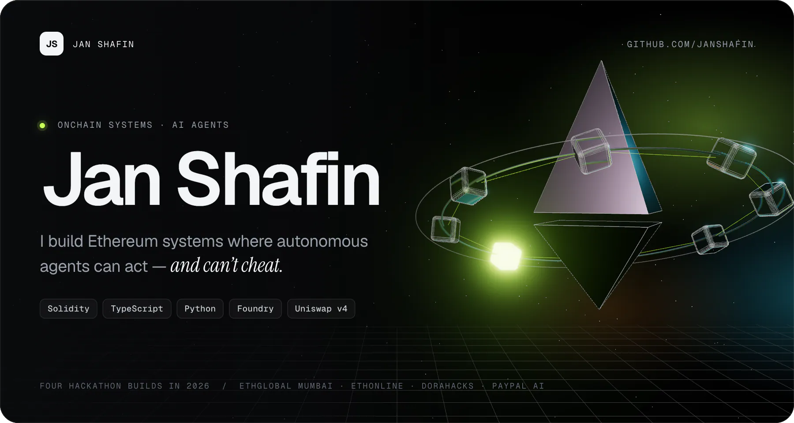
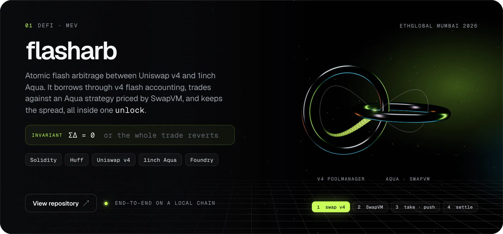
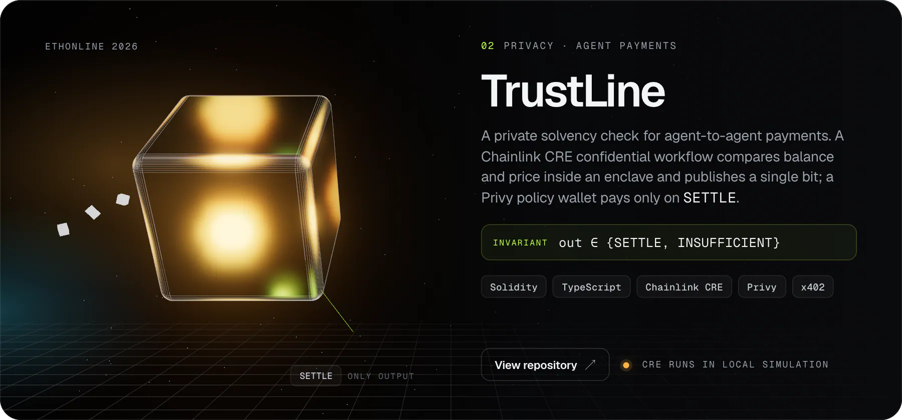
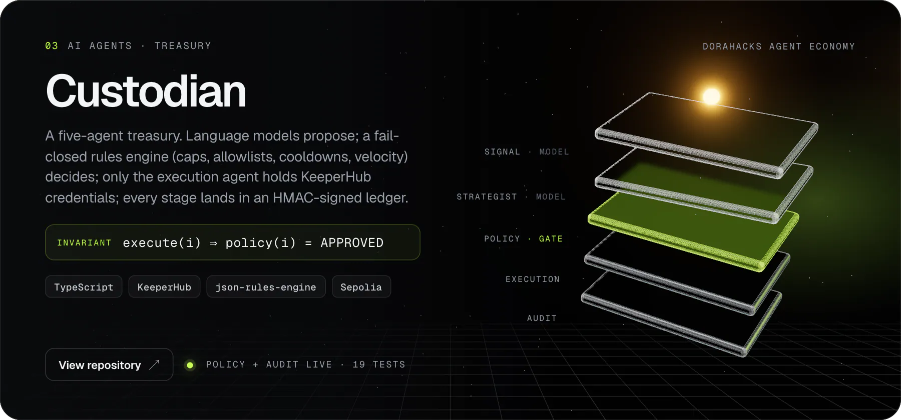
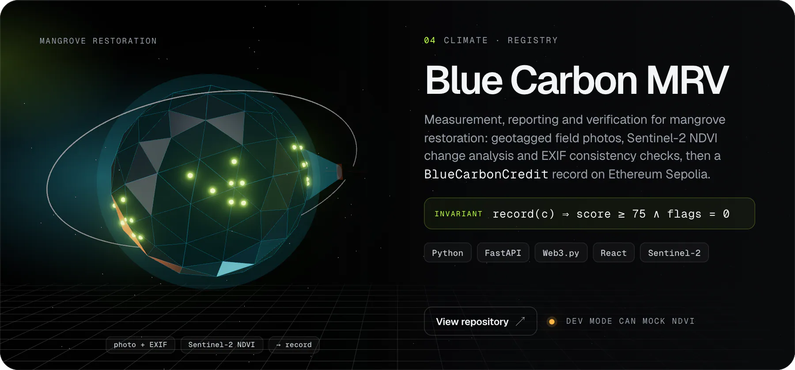
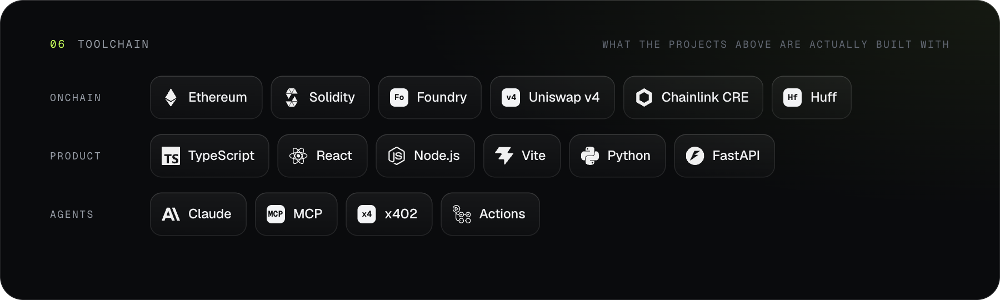
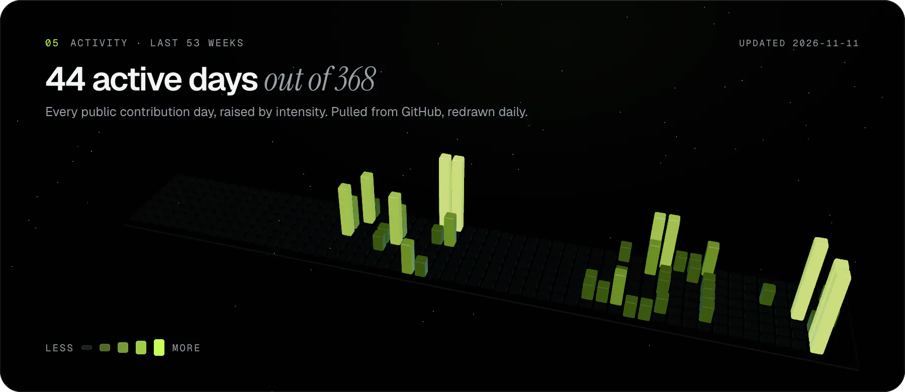
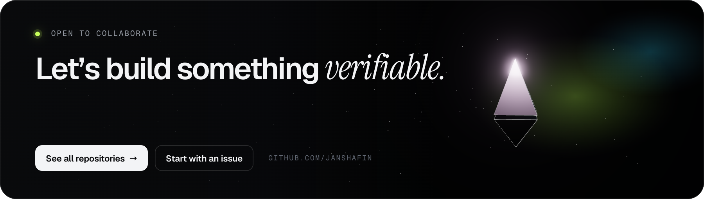

<!--
  Every image on this profile is a real-time Three.js scene, rendered frame by frame
  in headless Chrome and encoded as animated WebP:   cd studio && npm ci && node render.mjs
  The activity skyline is rebuilt daily from GitHub's public contribution calendar.
-->

Also building &nbsp;·&nbsp; <a href="https://github.com/Janshafin/ADGENT">ADGENT</a>: ads inside AI shopping agents over MCP, paid only when a PayPal sale settles (PayPal AI Hackathon 2026) &nbsp;·&nbsp; <a href="https://github.com/Janshafin/gigforce">GigForge</a>: an AI co-founder toolkit for freelancers.
