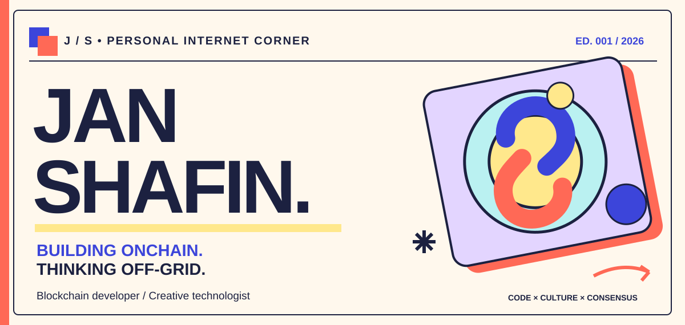
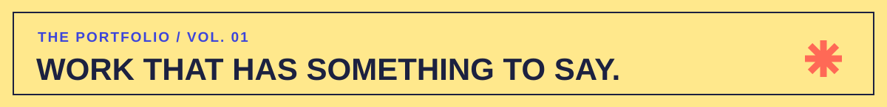
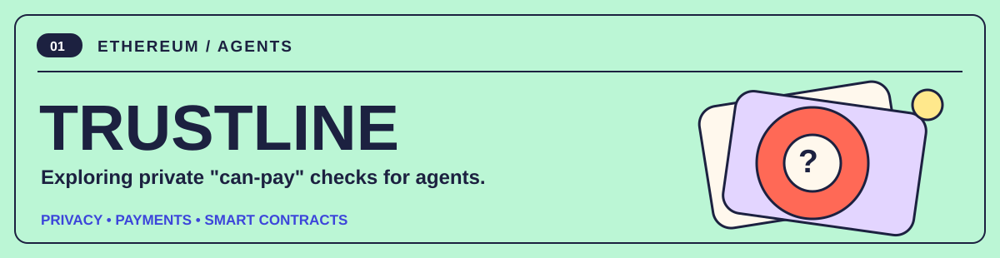
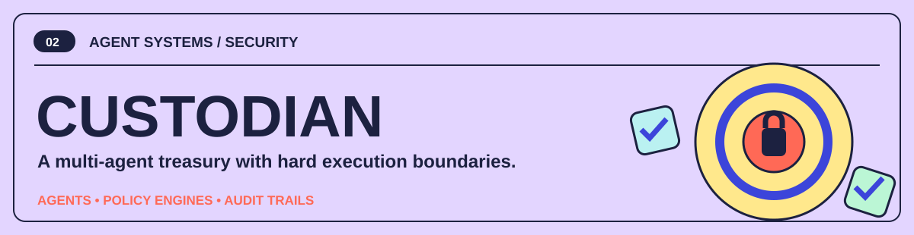
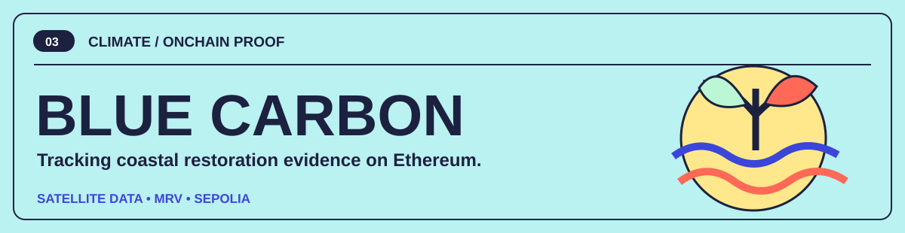
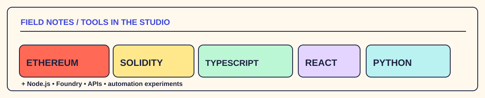
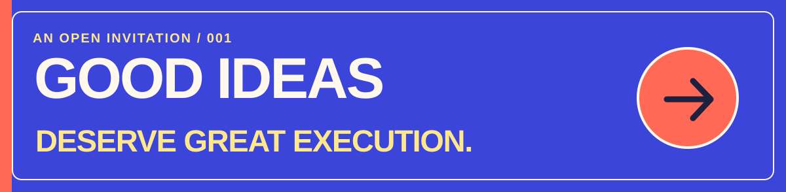

<!--
  JAN SHAFIN — THE PERSONAL INTERNET STUDIO
  An editorial GitHub profile, designed as a lightweight illustrated portfolio.
  All artwork is hand-authored SVG; no remote image hosts or activity widgets.
-->

  

 

  <a href="#a-little-about-me"><b>THE PERSON</b></a> &nbsp; / &nbsp;
  <a href="#selected-work"><b>SELECTED WORK</b></a> &nbsp; / &nbsp;
  <a href="#the-toolbox"><b>THE TOOLBOX</b></a> &nbsp; / &nbsp;
  <a href="#say-hello"><b>SAY HELLO</b></a>

 

### A little about me

**Hey, I’m Jan.** I build at the intersection of **blockchain infrastructure, autonomous agents, and expressive digital experiences**.

I like two things that don’t always meet: systems you can *verify* and interfaces you actually *want to use*. My GitHub is a collection of experiments in making that overlap real—from privacy-minded agent payments to climate verification and practical AI tools.

**The working philosophy:** make it technically interesting, make it useful, and give it a point of view.

 

### Selected work

  

 

**[Explore TrustLine ↗](https://github.com/Janshafin/TrustLine)** — A hackathon prototype investigating how payment agents can check affordability without exposing a full balance. Its repo distinguishes real integrations from simulated components.

 

**[Explore Custodian ↗](https://github.com/Janshafin/Custodian)** — Agent decisions meet deterministic guardrails: signals, strategy, policy checks, controlled execution, and an audit trail.

 

**[Explore Blue Carbon MRV ↗](https://github.com/Janshafin/Blue-Carbon-MRV)** — A blue-carbon measurement and verification workflow combining field evidence, satellite vegetation analysis, and an Ethereum Sepolia registry. The project supports clearly labeled simulated satellite data for demonstrations.

 

**[Explore GigForge ↗](https://github.com/Janshafin/gigforce)** — An interface-led exploration of AI-assisted lead generation, proposals, and independent-work operations.

 

### The toolbox

A toolkit, not a personality. I choose the stack around what the idea needs.

 

### Outside the code

I care about **interaction, typography, systems thinking, and the tiny details that make technology feel human**. A product should have both a clear architecture *and* a pulse.

 

### Say hello

  

 

  <b>Have something ambitious, unusual, or beautifully complicated in mind?</b>
  
I'd love to see what you're building.

  <a href="https://github.com/Janshafin?tab=repositories">EXPLORE THE REPOS</a> &nbsp; · &nbsp;
  <a href="https://github.com/Janshafin">FIND ME ON GITHUB</a>
    
  Designed with curiosity • built to be read, not counted

