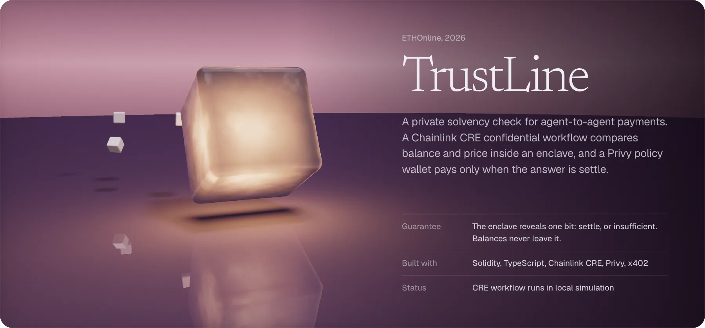
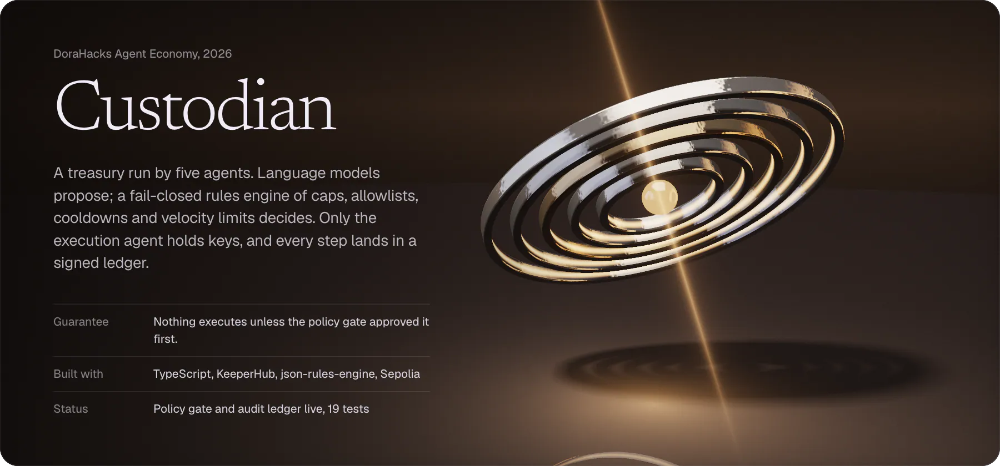
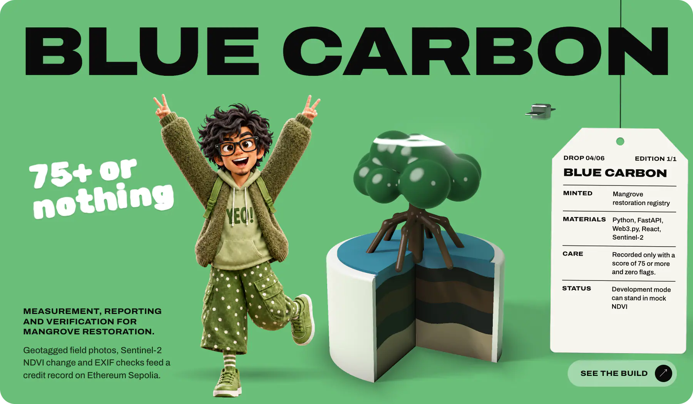
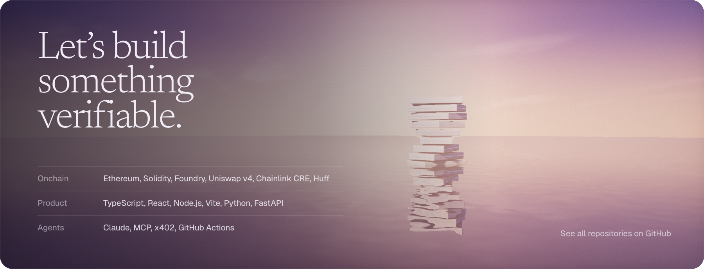

<!--
  THE DROP. Every plate is rendered in studio/: ray-marched GLSL toys, the portfolio's figurines and
  Archivo type, captured frame by frame in headless Chrome:   cd studio && npm ci && node render.mjs
  Receipts (the activity plate) is rebuilt nightly from GitHub's public contribution calendar.
-->

  <a href="https://janshafin.github.io/My_Portfolio/"><b>Portfolio</b></a> &nbsp;&nbsp;
  <a href="mailto:janshafin09@gmail.com"><b>janshafin09@gmail.com</b></a> &nbsp;&nbsp;
  <a href="tel:+916369056143"><b>+91 63690 56143</b></a> &nbsp;&nbsp;
  <a href="https://gigforce-iota.vercel.app"><b>GigForge, live</b></a>

