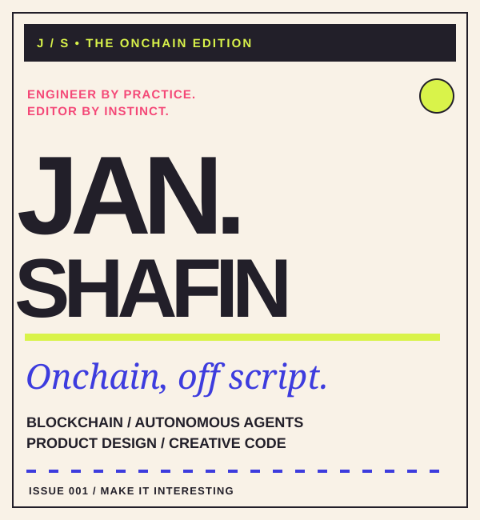
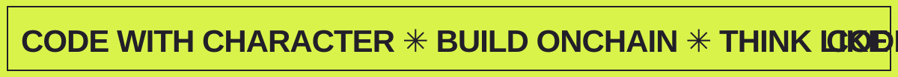
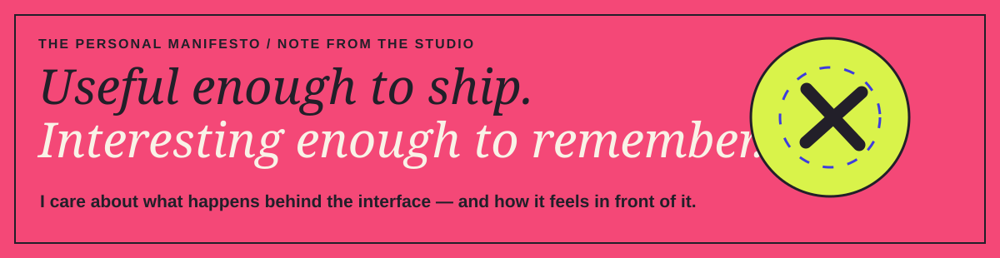
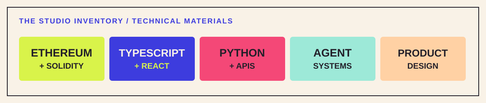
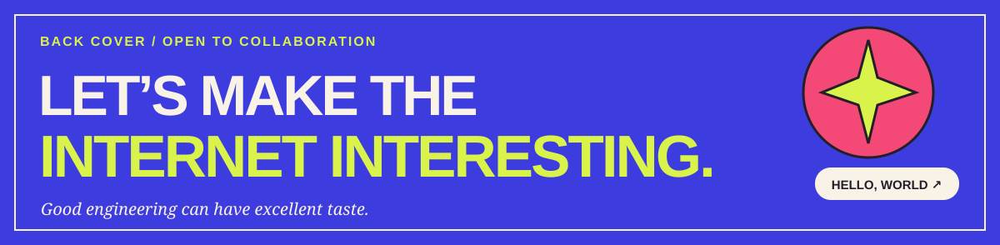

<!--
JAN SHAFIN / THE ONCHAIN EDITION
A deliberately art-directed GitHub profile, not a dashboard.
Original self-hosted SVG artworks. Motion respects reduced-motion settings.
-->

  

 

  <a href="#the-person">THE PERSON</a> &nbsp; / &nbsp;
  <a href="#the-collection">THE COLLECTION</a> &nbsp; / &nbsp;
  <a href="#the-runway">THE RUNWAY</a> &nbsp; / &nbsp;
  <a href="#the-studio">THE STUDIO</a>

 

 

### 00 / The person

**Hey, I'm Jan.** I build things at the intersection of **Ethereum, autonomous agents, and product design**.

I'm interested in making systems that are **technically defensible** and **visually memorable**. Smart contracts, verifiable workflows, practical AI tools — built with the attention you'd give a well-directed campaign.

I don't want technology to look identical just because it uses the same stack.

 

 

### 01 / The collection

*Four projects. Four different questions worth exploring. Click a look to open the repository.*

**[LOOK 01 — TrustLine ↗](https://github.com/Janshafin/TrustLine)** · Private solvency checks for agents, designed to assess a deal without publishing the payer's full balance. *An experimental hackathon system; the repository documents which components are simulated.*

 

**[LOOK 02 — Custodian ↗](https://github.com/Janshafin/Custodian)** · A multi-agent treasury experiment where probabilistic decisions meet deterministic approval rules, execution boundaries, and an auditable trail.

 

**[LOOK 03 — Blue Carbon MRV ↗](https://github.com/Janshafin/Blue-Carbon-MRV)** · Field submissions, satellite vegetation analysis, and an Ethereum Sepolia registry for exploring blue-carbon verification. *Development mode can use clearly labeled simulated satellite signals.*

 

**[LOOK 04 — GigForge ↗](https://github.com/Janshafin/gigforce)** · A product experiment for freelancers: lead discovery, proposals, and the operational work that competes with actually making things.

 

### 02 / The runway

*Not a snake. A living record of actual work, interpreted as a runway grid.*

The squares reflect the public contribution levels GitHub publishes; the artwork is regenerated by a repository workflow. No fabricated streak counts, no external stats service.

  

### 03 / The studio

**Materials I keep returning to:** Solidity / Ethereum · TypeScript · React · Python · APIs · automated workflows · interface systems.

I don't want every problem to become a token. I want the chain, the agent, and the interface to each earn their place.

 

### 04 / Back cover

   
  <b>Have a technically ambitious, visually unusual project in mind?</b>
    
  <a href="https://github.com/Janshafin?tab=repositories"><b>EXPLORE THE WORK ↗</b></a> &nbsp; · &nbsp;
  <a href="https://github.com/Janshafin"><b>FIND ME ON GITHUB ↗</b></a>
    
  THE ONCHAIN EDITION — INDEPENDENT BY DESIGN.

