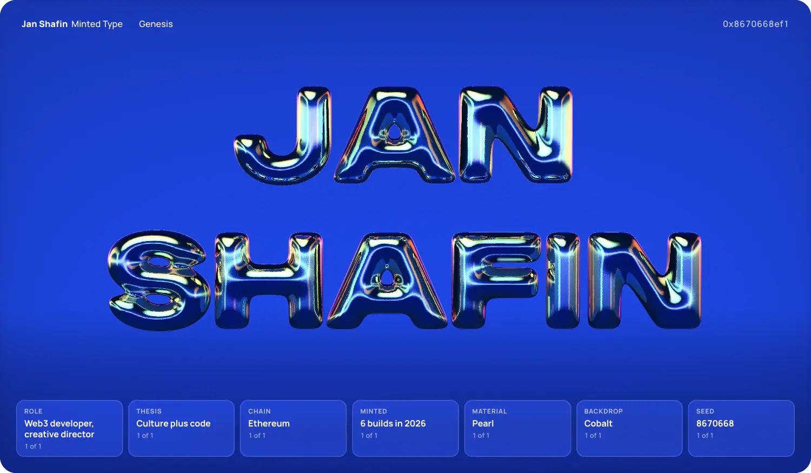
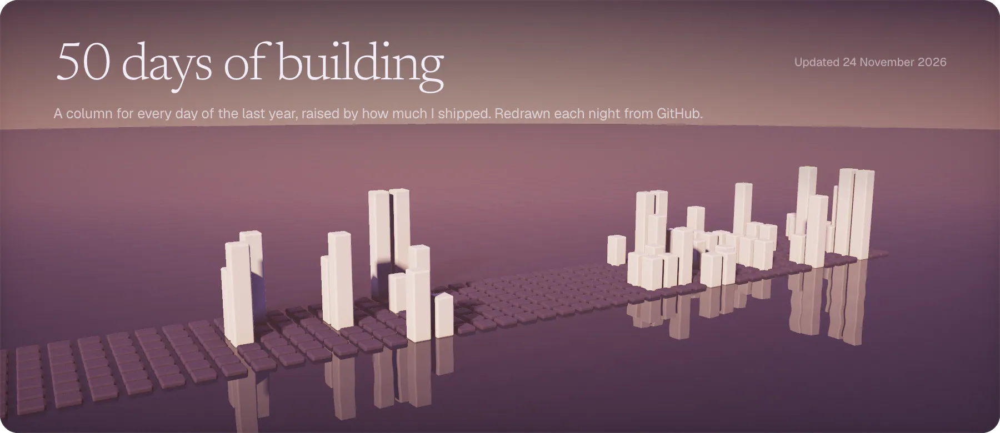

<!--
  Every image on this profile is a ray-marched GLSL scene, rendered frame by frame in headless
  Chrome and encoded as animated WebP:   cd studio && npm ci && node render.mjs
  The activity plate is rebuilt nightly from GitHub's public contribution calendar.
-->

Also building <a href="https://github.com/Janshafin/ADGENT">ADGENT</a>, ads inside AI shopping agents over MCP that are paid only when a PayPal sale settles (PayPal AI Hackathon 2026), and <a href="https://github.com/Janshafin/gigforce">GigForge</a>, an AI co-founder toolkit for freelancers.
