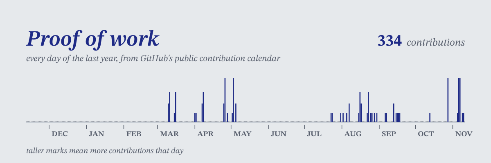

**Abstract.** I'm Jan, an engineering student who builds Ethereum and agent systems, mostly against hackathon deadlines. The projects below all start from the same question: what must stay true no matter what the market, the model or the operator does? Each one answers it with a single rule enforced in code.

 

[flasharb](https://github.com/Janshafin/flasharb) borrows through Uniswap v4 flash accounting, trades against a 1inch Aqua strategy and keeps the spread, all inside one `PoolManager.unlock`. It runs end to end on a local chain, with a searcher bot and a dashboard that shows each trade's call trace.

 

[FEALTY](https://github.com/Janshafin/FEALTY) is a game of contested power built on unmodified ENSv2 registries. The `Throne` contract has no owner, no pause and no upgrade path, and every vote carries a World ID proof, so each human gets one ballot.

 

[Custodian](https://github.com/Janshafin/Custodian) splits a treasury agent into five roles with separate privileges. The language models only read and suggest. A rules engine decides, rejects anything it can't verify, and only then hands the transaction to KeeperHub.

 

[Blue Carbon MRV](https://github.com/Janshafin/Blue-Carbon-MRV) scores field photos and vegetation change before it writes to a `BlueCarbonCredit` contract on Sepolia. For local development it can use a clearly labelled mock vegetation signal in place of Sentinel-2.

 

**Open problem.** flasharb's Huff executor. Its first milestone matches the Solidity reference in 33 differential tests, but `arb` doesn't run in Huff yet. That's next, followed by the `ArbTax` Aqua position.

**Also built.** [TrustLine](https://github.com/Janshafin/TrustLine) explores private solvency checks before agents pay each other. The Privy wallet and the Sepolia payment are live, and the confidential step is still simulated. [ADGENT](https://github.com/Janshafin/ADGENT) puts labelled sponsored offers inside AI shopping agents over MCP, and merchants pay only when a PayPal sale settles.

 

Set in STIX Two. The plates are generated by <a href="./design/build.py">design/build.py</a>, and a daily workflow redraws the proof-of-work graph from GitHub's public contribution calendar.
