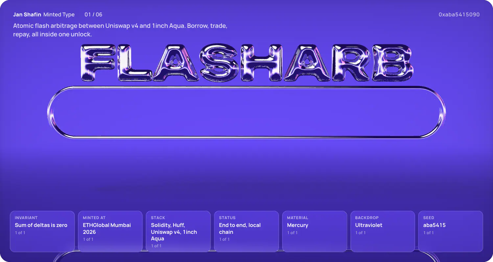
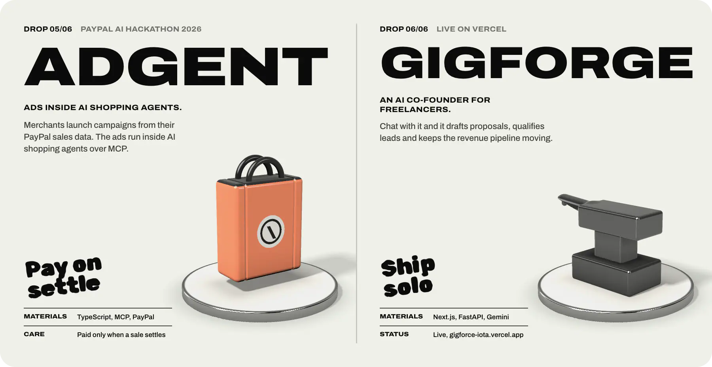
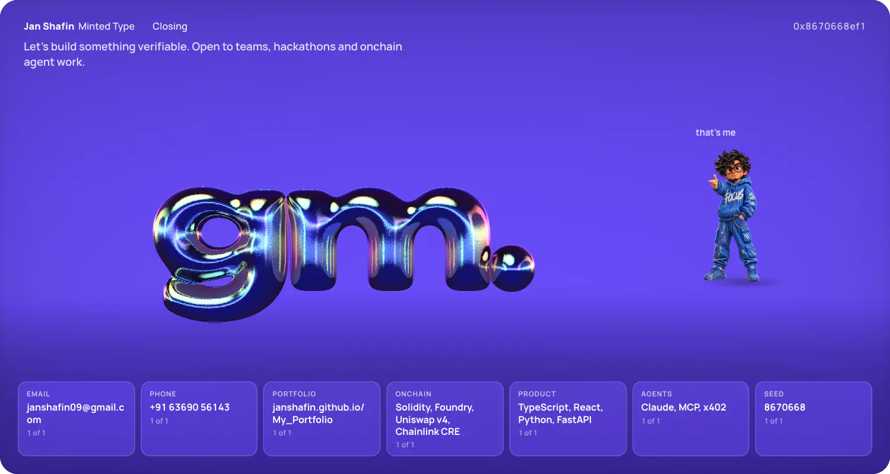

<!--
  MINTED TYPE. Every plate is rendered in studio/: inflated 3D letters ray-marched from Unbounded
  glyph distance fields, with backdrop, material and motion seeded by each repo's latest commit hash.
      cd studio && npm ci && node render.mjs
  Receipts is rebuilt nightly from GitHub's public contribution calendar.
-->

  <a href="https://janshafin.github.io/My_Portfolio/"><b>Portfolio</b></a> &nbsp;&nbsp;
  <a href="mailto:janshafin09@gmail.com"><b>janshafin09@gmail.com</b></a> &nbsp;&nbsp;
  <a href="tel:+916369056143"><b>+91 63690 56143</b></a> &nbsp;&nbsp;
  <a href="https://gigforce-iota.vercel.app"><b>GigForge, live</b></a>

